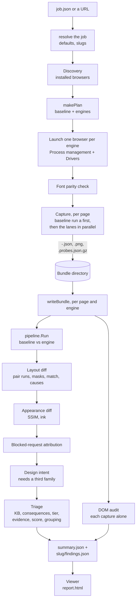
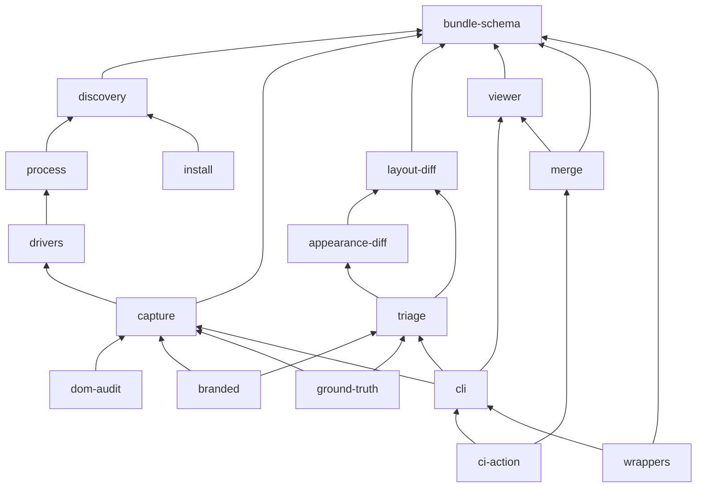

# Architecture

Omnisnap is one Go binary, `omnisnap`, built from [`cmd/omnisnap`](https://github.com/GerMP21/Omnisnap/blob/main/cmd/omnisnap/main.go). `main` only calls `cli.Main`, which returns an exit code and never calls `os.Exit`, so the whole program is testable as a function ([`internal/cli/root.go`](https://github.com/GerMP21/Omnisnap/blob/main/internal/cli/root.go)). The npm and PyPI packages and the GitHub Action all run this binary; none of them reimplements anything.

A second binary, `omnisnap-lab` ([`cmd/omnisnap-lab`](https://github.com/GerMP21/Omnisnap/blob/main/cmd/omnisnap-lab/main.go)), is the ground-truth tooling: the crawl, mutation testing, the dataset and the fingerprint table. It shares the capture pipeline with the product and is never released ([Ground truth and the model](Ground-Truth-and-the-Model)).

## One job, end to end

`omnisnap <url>` and `omnisnap run job.json` both end in `runJob` ([`internal/cli/run.go`](https://github.com/GerMP21/Omnisnap/blob/main/internal/cli/run.go)). It runs in two halves: **capture**, which talks to browsers and writes files, and **analysis**, which reads those files and is pure computation.

Step by step, with the code that does it:

1. **Resolve and discover.** The job gets its defaults and page slugs; discovery lists the installed browsers without launching any ([`run.go`](https://github.com/GerMP21/Omnisnap/blob/main/internal/cli/run.go)). See [Discovery](Discovery).
2. **Plan.** `makePlan` picks the baseline (a Blink browser, Chrome by default) and the engines to compare ([`run.go`](https://github.com/GerMP21/Omnisnap/blob/main/internal/cli/run.go)). Fewer than two engine families, or no baseline, is exit code 2.
3. **Launch.** One browser per engine for the whole job, each wrapped in a `restartable` so a crashed browser can be replaced once ([`run.go`](https://github.com/GerMP21/Omnisnap/blob/main/internal/cli/run.go)). An engine that fails to launch is skipped with its reason. See [Process management](Process-Management) and [Drivers](Drivers).
4. **Font parity.** When the job's `fontParity` is on (the default), the engines are checked for the same fonts before anything is captured ([`run.go`](https://github.com/GerMP21/Omnisnap/blob/main/internal/cli/run.go)).
5. **Capture.** Per page, `capture.RunPage` captures the baseline's run a first. If the page is unreachable or a bot wall, nothing else is captured. Then the protocol lanes run in parallel: CDP and BiDi engines together, WebDriver Classic (WebKit) alone, each doing every engine's run a before any run b ([`run.go`](https://github.com/GerMP21/Omnisnap/blob/main/internal/cli/run.go), [`lanes.go`](https://github.com/GerMP21/Omnisnap/blob/main/internal/capture/lanes.go)). See [Capture pipeline](Capture-Pipeline).
6. **Analyse.** `writeBundle` reads the captures back and, for each page and each compared engine, runs the DOM audit on both captures and `pipeline.Run` on the pair ([`bundle.go`](https://github.com/GerMP21/Omnisnap/blob/main/internal/cli/bundle.go)). The pipeline is layout diff, then appearance, blocked-request attribution, design intent and triage ([`internal/pipeline/diff.go`](https://github.com/GerMP21/Omnisnap/blob/main/internal/pipeline/diff.go)).
7. **Write.** `summary.json`, a per-page `findings.json` with the full evidence, `host.json`, and the viewer's `report.html` ([`bundle.go`](https://github.com/GerMP21/Omnisnap/blob/main/internal/cli/bundle.go)). See [Data contracts](Data-Contracts) and [Viewer](Viewer).

Exit code 0 means the job completed, whatever it found: Omnisnap is report-only ([CLI and orchestration](CLI-and-Orchestration)).

### Why the two halves are separate

Analysis never touches a browser: it reads capture files and returns values. That is why the layout diff, triage and appearance code is tested on committed golden captures ([`testdata/golden`](https://github.com/GerMP21/Omnisnap/tree/main/testdata/golden)) without a browser, and why `--resume` can skip the pages whose captures already exist and still rebuild the whole `summary.json` from the files. (`omnisnap merge` does not re-analyse: it concatenates finished results from several machines, each with its own baseline; see [Merge and PR comment](Merge-and-PR-Comment).)

## The modules

Module ids are stable; specs, plans and tasks refer to them. The graph is the one in [`specs/CAPABILITY-MAP.md`](https://github.com/GerMP21/Omnisnap/blob/main/specs/CAPABILITY-MAP.md); arrows point from a module to what it depends on.

`cli` depends on every runtime module; the graph shows only its main edges.

| Module | Package(s) | Wiki page |
|---|---|---|
| `bundle-schema` | [`internal/schema`](https://github.com/GerMP21/Omnisnap/tree/main/internal/schema), [`schema/`](https://github.com/GerMP21/Omnisnap/tree/main/schema) | [Data contracts](Data-Contracts) |
| `discovery` | [`internal/discovery`](https://github.com/GerMP21/Omnisnap/tree/main/internal/discovery) | [Discovery](Discovery) |
| `process` | [`internal/process`](https://github.com/GerMP21/Omnisnap/tree/main/internal/process) | [Process management](Process-Management) |
| `drivers` | [`internal/drivers`](https://github.com/GerMP21/Omnisnap/tree/main/internal/drivers) | [Drivers](Drivers) |
| `capture` | [`internal/capture`](https://github.com/GerMP21/Omnisnap/tree/main/internal/capture), [`assets/inject`](https://github.com/GerMP21/Omnisnap/tree/main/assets/inject) | [Capture pipeline](Capture-Pipeline) |
| `dom-audit` | [`internal/domaudit`](https://github.com/GerMP21/Omnisnap/tree/main/internal/domaudit) | [DOM audit](DOM-Audit) |
| `layout-diff` | [`internal/layoutdiff`](https://github.com/GerMP21/Omnisnap/tree/main/internal/layoutdiff), [`internal/selector`](https://github.com/GerMP21/Omnisnap/tree/main/internal/selector) | [Layout diff](Layout-Diff) |
| `appearance-diff` | [`internal/appearance`](https://github.com/GerMP21/Omnisnap/tree/main/internal/appearance) | [Appearance diff](Appearance-Diff) |
| `triage` | [`internal/triage`](https://github.com/GerMP21/Omnisnap/tree/main/internal/triage), [`assets/model`](https://github.com/GerMP21/Omnisnap/tree/main/assets/model) | [Triage](Triage) |
| `branded` | [`internal/branded`](https://github.com/GerMP21/Omnisnap/tree/main/internal/branded) | [Branded browsers](Branded-Browsers) |
| `ground-truth` | [`internal/groundtruth`](https://github.com/GerMP21/Omnisnap/tree/main/internal/groundtruth), [`cmd/omnisnap-lab`](https://github.com/GerMP21/Omnisnap/tree/main/cmd/omnisnap-lab), [`tools/train.py`](https://github.com/GerMP21/Omnisnap/blob/main/tools/train.py) | [Ground truth and the model](Ground-Truth-and-the-Model) |
| `viewer` | [`internal/viewer`](https://github.com/GerMP21/Omnisnap/tree/main/internal/viewer) | [Viewer](Viewer) |
| `cli` | [`internal/cli`](https://github.com/GerMP21/Omnisnap/tree/main/internal/cli), [`internal/pipeline`](https://github.com/GerMP21/Omnisnap/tree/main/internal/pipeline) | [CLI and orchestration](CLI-and-Orchestration) |
| `install` | [`internal/install`](https://github.com/GerMP21/Omnisnap/tree/main/internal/install) | [Install](Install) |
| `merge` | [`internal/merge`](https://github.com/GerMP21/Omnisnap/tree/main/internal/merge) | [Merge and PR comment](Merge-and-PR-Comment) |
| `ci-action` | [`action/`](https://github.com/GerMP21/Omnisnap/tree/main/action), [`.github/workflows/report.yml`](https://github.com/GerMP21/Omnisnap/blob/main/.github/workflows/report.yml) | [GitHub Action](GitHub-Action) |
| `wrappers` | [`packages/npm`](https://github.com/GerMP21/Omnisnap/tree/main/packages/npm), [`packages/pypi`](https://github.com/GerMP21/Omnisnap/tree/main/packages/pypi) | [Wrappers](Wrappers) |

`internal/pipeline` is the glue between capture files and `summary.json`: it runs the analysis half for one page pair. It has no spec of its own; its behaviour is the sum of the layout-diff, appearance-diff and triage specs.

## Concurrency in one sentence

Pages are captured one after another; within a page, the baseline's first run goes alone, then the CDP+BiDi lane and the Classic lane run in parallel, each sequentially; analysis is sequential per page and engine. A page cannot drift between engines because every engine's run a is taken before any run b.

## Spec

[`specs/CAPABILITY-MAP.md`](https://github.com/GerMP21/Omnisnap/blob/main/specs/CAPABILITY-MAP.md) (modules, dependencies, build order) and [`specs/CONVENTIONS.md`](https://github.com/GerMP21/Omnisnap/blob/main/specs/CONVENTIONS.md) (shared rules).

## Source files

- [`cmd/omnisnap/main.go`](https://github.com/GerMP21/Omnisnap/blob/main/cmd/omnisnap/main.go): where a run starts
- [`internal/cli/run.go`](https://github.com/GerMP21/Omnisnap/blob/main/internal/cli/run.go): the job, end to end
- [`internal/pipeline/diff.go`](https://github.com/GerMP21/Omnisnap/blob/main/internal/pipeline/diff.go): the analysis of one page pair
- [`specs/CAPABILITY-MAP.md`](https://github.com/GerMP21/Omnisnap/blob/main/specs/CAPABILITY-MAP.md): the module map the specs follow
