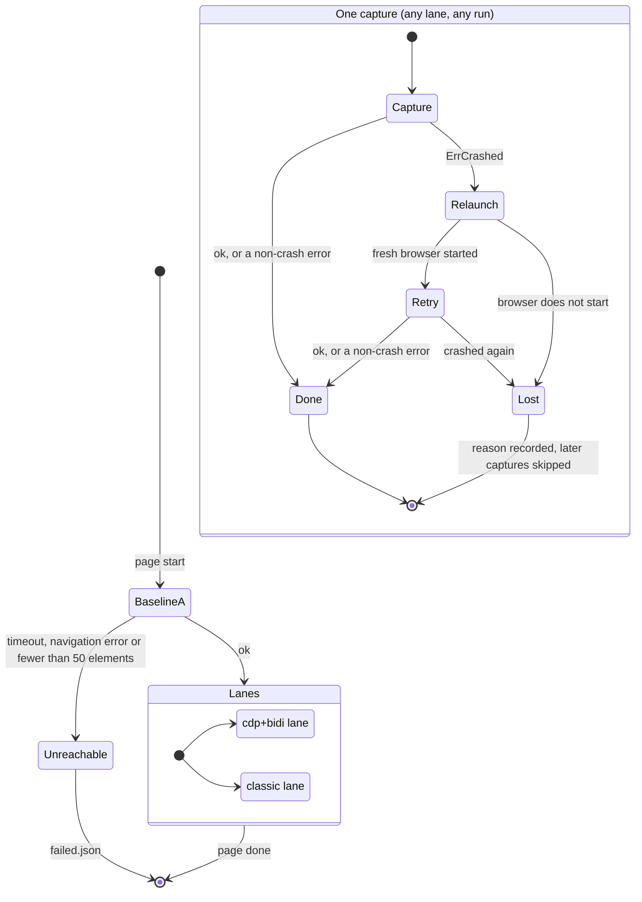

# Capture pipeline

**Role.** Produce **comparable** captures: every engine at the same viewport, the page settled to the same state, geometry and screenshot taken at the same moment, written into the bundle. Everything downstream measures differences between captures, so anything that varies here for a reason other than the engine becomes a false finding. Module `capture`, package [`internal/capture`](https://github.com/GerMP21/Omnisnap/tree/main/internal/capture), with the in-page scripts in [`assets/inject`](https://github.com/GerMP21/Omnisnap/tree/main/assets/inject).

## Inputs and outputs

- **In:** a [`Plan`](https://github.com/GerMP21/Omnisnap/blob/main/internal/capture/lanes.go) (output dir, viewport, timeouts, run count, engines with their session factories, the baseline, resume flags, `NoProbes`, `AllowSmallPages`, the job's `Lost` set) and one page.
- **Out:** per engine and run, `<engine>-<run>.json`, `.png` and `.probes.json.gz`, or `.error.txt`; `page.json`; `failed.json` for an unreachable page ([Data contracts](Data-Contracts)). An [`Outcome`](https://github.com/GerMP21/Omnisnap/blob/main/internal/capture/lanes.go) per capture goes to the CLI for progress events.

## One capture: `Page`

[`Page`](https://github.com/GerMP21/Omnisnap/blob/main/internal/capture/page.go) first removes any previous attempt's files for this engine and run, so the bundle never holds a capture and an error for the same run. Then ([`page.go`](https://github.com/GerMP21/Omnisnap/blob/main/internal/capture/page.go)):

1. **Viewport.** `SetViewport` to the job's viewport (1280×800 at DPR 1 by default).
2. **Navigate**, within the navigation timeout (30 s by default), then **settle**: network idle (500 ms with no request in flight, at most 8 s) where the driver can tell, a fixed 1.5 s on WebDriver Classic ([`capture.go`](https://github.com/GerMP21/Omnisnap/blob/main/internal/capture/capture.go)). Not reaching idle is not an error: some pages poll forever.
3. **Stabilize** with [`stabilize.js`](https://github.com/GerMP21/Omnisnap/blob/main/assets/inject/stabilize.js): hide the root scrollbar and gutter (Chrome keeps a 15 px gutter for `scrollbar-gutter: stable` even with hidden scrollbars), wait for `document.fonts.ready`, scroll in steps to trigger lazy content (a jump to the bottom skips the `IntersectionObserver` callbacks in the middle), wait for images, jump finite animations to their end and freeze infinite ones at t=0, then **freeze JavaScript timers** so the geometry and the screenshot describe the same moment. Settle again, at most 5 s.
4. **Extract** with [`extract.js`](https://github.com/GerMP21/Omnisnap/blob/main/assets/inject/extract.js): the geometry tree, at most 20,000 nodes (`meta.truncated` when the cap is hit). The page's DOM is read through the platform's own accessors, never through properties the page can shadow: a `<form>` exposes its controls as properties (`form.id` is `<input name="id">`), and a custom element can redefine anything. Each node records its position among its same-tag siblings (`nt`), counted over every element child, including the `display: none` ones the tree leaves out, so a selector's `:nth-of-type` names the element the browser would. The children of an open shadow root carry `sr`, so a selector can name their host instead.
5. **Evidence** ([`evidence.go`](https://github.com/GerMP21/Omnisnap/blob/main/internal/capture/evidence.go)):
   - the full-page **screenshot**, capped at 2560×16000 px;
   - a **re-measure** with `extract.js`, stored as `meta.post`: if the height or node count changed, the page moved while it was captured, and the result will carry a warning;
   - the four **probes** ([`probes.go`](https://github.com/GerMP21/Omnisnap/blob/main/internal/capture/probes.go)): `probes.js` is installed, then for each of `lh`, `font`, `controls` and `all` the probe is applied, the page re-extracted, and the probe reverted. The four trees are gzipped with a zero mtime, so the same page gives byte-identical files. `probes: false` in the job skips them;
   - a note when the window could not be sized to the viewport, instead of measuring it silently.
6. **Failed requests** are copied into the capture; those failing with `BLOCKED_BY_CLIENT` are counted as blocked (they explain branded browsers).
7. **Write** the JSON **last**, atomically. Its presence means the capture is complete; on any failure the PNG is removed and `.error.txt` holds the error.

Every driver call has a deadline: navigation its own, every other step the script timeout, so a hung renderer cannot stall a job.

The three scripts are the spike's, byte for byte: the precision results were measured with them. [`SHA256SUMS`](https://github.com/GerMP21/Omnisnap/blob/main/assets/inject/SHA256SUMS) pins each one; `TestEmbeddedScriptsMatchManifest` and `TestScriptsAreTheSpikeOriginals` fail if a script changes ([`embed.go`](https://github.com/GerMP21/Omnisnap/blob/main/assets/inject/embed.go)).

## One page: runs and lanes

[`RunPage`](https://github.com/GerMP21/Omnisnap/blob/main/internal/capture/lanes.go):

1. **The baseline's run a goes first, alone.** If it times out, fails to navigate, or renders fewer than 50 elements (a bot wall), the page is **unreachable**: `failed.json` is written and nothing else is captured ([`policy.go`](https://github.com/GerMP21/Omnisnap/blob/main/internal/capture/policy.go)). `--allow-small-pages` drops the size rule only. `Plan.FullCapture` (the lab) disables this policy.
2. **Then the lanes, in parallel** ([`lanes`](https://github.com/GerMP21/Omnisnap/blob/main/internal/capture/lanes.go)): `cdp+bidi` (Blink and Gecko engines) and `classic` (WebKit). Within a lane, captures are sequential: **every engine's run a, then every engine's run b** ([`runLane`](https://github.com/GerMP21/Omnisnap/blob/main/internal/capture/lanes.go)). A page cannot drift between engines, and run b exists to reveal dynamic content.
3. An engine whose run a failed skips its later runs.

`RunPage` sees one group of engines at a time: when a job has more engines than `--max-browsers`, the CLI calls it for every page with each group in turn ([CLI and orchestration](CLI-and-Orchestration)), and only the first group's `Plan` names the baseline.

### Crashes

A capture that fails with `ErrCrashed` is retried **once, in a fresh browser** ([`captureRetrying`](https://github.com/GerMP21/Omnisnap/blob/main/internal/capture/crash.go)): `Engine.Relaunch` replaces the browser (the CLI's `restartable` wrapper does the work), and the capture runs again. If the retry crashes too, or the browser cannot start again, the engine is **lost** for the rest of the job: the reason goes into the shared [`Lost`](https://github.com/GerMP21/Omnisnap/blob/main/internal/capture/crash.go) set, the CLI prints one `LOST` line and sends an `engine` event with status `failed`, and every later capture of that engine is written as `.error.txt` with `skipped: <reason>`. The other engines go on. A lost baseline does not make a page unreachable: the crash was the browser's, not the page's. Navigation errors and timeouts are never retried.

### Resume

`--resume` asks [`ResumeState`](https://github.com/GerMP21/Omnisnap/blob/main/internal/capture/resume.go) per page: a page is done when every engine was attempted to the end (its last run captured or failed, or its run a failed), or when it is marked unreachable. Done pages are skipped. An error file counts as an attempt, unless `--retry-failed` asks for it again; that flag also retries unreachable pages.

## Fonts

When the job's `fontParity` is on, the CLI runs the font probe in every engine before its first page (per group, compared with the baseline's report from the first group) ([`fonts.go`](https://github.com/GerMP21/Omnisnap/blob/main/internal/capture/fonts.go)): it measures what `serif`, `sans-serif` and `monospace` resolve to (a name counts as resolved only if it measures the same with two different fallbacks behind it, since a missing font falls back silently) and which scripts have an installed font. A mismatch with the baseline, or a script with no font, is a job warning ([`FontWarnings`](https://github.com/GerMP21/Omnisnap/blob/main/internal/capture/fonts.go)). `omnisnap check-fonts` prints the same table. The launch settings in [Process management](Process-Management) are what make the fonts match; this only verifies them.

## Failure handling

| What fails | Result |
|---|---|
| Baseline run a: timeout, navigation error, bot wall | page `unreachable`, `failed.json`, nothing else captured |
| Any other capture | `.error.txt`; that engine's later runs on the page are skipped |
| A crash | one retry in a fresh browser; then the engine is lost for the job |
| The job's context (Ctrl-C) | the lanes stop; the CLI closes every browser |

## Tests

- Unit tests with a fake session ([`fake_test.go`](https://github.com/GerMP21/Omnisnap/blob/main/internal/capture/fake_test.go)): `TestCaptureOnePage`, `TestScreenshotIsCapped`, `TestNoNetworkIdleMeansFixedSettle`, `TestFailureWritesErrorFileOnly`, `TestEveryStepHasADeadline`, `TestRetryReplacesPreviousAttempt`.
- Order and concurrency: `TestRunPageOrder`, `TestLanesOverlap`, `TestRunPageReportsFailuresAndContinues` ([`lanes_test.go`](https://github.com/GerMP21/Omnisnap/blob/main/internal/capture/lanes_test.go)).
- The failure policy and resume: [`policy_test.go`](https://github.com/GerMP21/Omnisnap/blob/main/internal/capture/policy_test.go), [`resume_test.go`](https://github.com/GerMP21/Omnisnap/blob/main/internal/capture/resume_test.go).
- Crashes: `TestCrashRetriedOnceInAFreshBrowser`, `TestCrashTwiceLosesTheEngine`, `TestLostBaselineIsNotUnreachable`, `TestCrashWithoutRestart`, `TestNavigationErrorIsNotRetried` ([`crash_test.go`](https://github.com/GerMP21/Omnisnap/blob/main/internal/capture/crash_test.go)).
- Probes: written, skippable, byte-deterministic ([`probes_test.go`](https://github.com/GerMP21/Omnisnap/blob/main/internal/capture/probes_test.go)).
- With real browsers (`browsers` tag): `TestViewportAcrossEngines`, `TestSingleBlinkCapture`, `TestProbeCost`, `TestLaneWallTime` (runs only with `OMNISNAP_COST=1`, on a quiet machine, and prints each lane's wall time) and `TestPlantedDiskBudget`.

## Where the code differs from the spec

Nothing found for the steps, the failure policy, the crash policy or resume. The WebKit viewport handling has its own delta spec, [`SPEC-capture-webkit-viewport.md`](https://github.com/GerMP21/Omnisnap/blob/main/specs/SPEC-capture-webkit-viewport.md).

## Spec

[`specs/SPEC-capture.md`](https://github.com/GerMP21/Omnisnap/blob/main/specs/SPEC-capture.md).

## Source files

- [`internal/capture/capture.go`](https://github.com/GerMP21/Omnisnap/blob/main/internal/capture/capture.go): `Options` and `Result`: viewport and timeouts
- [`internal/capture/page.go`](https://github.com/GerMP21/Omnisnap/blob/main/internal/capture/page.go): `Page`: navigate, settle, capture
- [`internal/capture/lanes.go`](https://github.com/GerMP21/Omnisnap/blob/main/internal/capture/lanes.go): `RunPage` and the lanes
- [`internal/capture/crash.go`](https://github.com/GerMP21/Omnisnap/blob/main/internal/capture/crash.go): the crash retry and lost engines
- [`internal/capture/policy.go`](https://github.com/GerMP21/Omnisnap/blob/main/internal/capture/policy.go): the failure policy and failure.json
- [`internal/capture/probes.go`](https://github.com/GerMP21/Omnisnap/blob/main/internal/capture/probes.go): the neutralizing probes
- [`internal/capture/evidence.go`](https://github.com/GerMP21/Omnisnap/blob/main/internal/capture/evidence.go): screenshot, post-settle state and probes for a capture
- [`internal/capture/fonts.go`](https://github.com/GerMP21/Omnisnap/blob/main/internal/capture/fonts.go): the font check
- [`internal/capture/resume.go`](https://github.com/GerMP21/Omnisnap/blob/main/internal/capture/resume.go): resuming a page that is already captured
- [`internal/capture/write.go`](https://github.com/GerMP21/Omnisnap/blob/main/internal/capture/write.go): writing capture JSON
- [`assets/inject/embed.go`](https://github.com/GerMP21/Omnisnap/blob/main/assets/inject/embed.go): the injected scripts, embedded and pinned by SHA256SUMS
