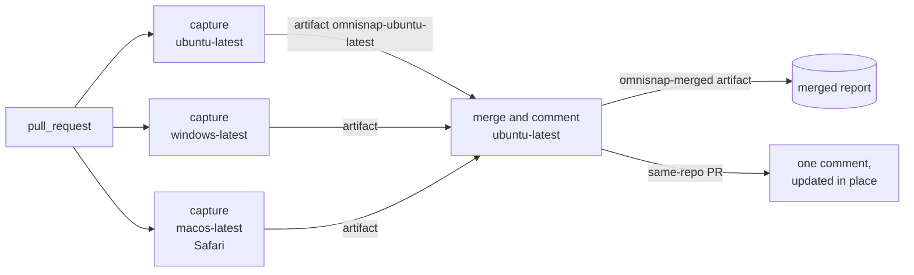

# GitHub Action

**Role.** Run Omnisnap on a pull request across Linux, Windows and macOS runners (macOS for real Safari), merge the three bundles into one report, and post **one** PR comment, updated in place on every push. **Report-only: every job concludes success, whatever it finds.** Module `ci-action`.

How to set it up in a repository is in [`docs/github-action-setup.md`](https://github.com/GerMP21/Omnisnap/blob/main/docs/github-action-setup.md), [`action/README.md`](https://github.com/GerMP21/Omnisnap/blob/main/action/README.md) and the [README](https://github.com/GerMP21/Omnisnap/blob/main/README.md); this page is about how it works.

## The pieces

| File | What it is |
|---|---|
| [`.github/workflows/report.yml`](https://github.com/GerMP21/Omnisnap/blob/main/.github/workflows/report.yml) | The **reusable workflow** a consumer calls: the OS jobs, the merge job, the comment. |
| [`action/action.yml`](https://github.com/GerMP21/Omnisnap/blob/main/action/action.yml) | The **composite action** each OS job runs: get the binary, prepare engines, start the app, capture, upload. Usable on its own. |
| [`action/linux-engines.sh`](https://github.com/GerMP21/Omnisnap/blob/main/action/linux-engines.sh) | Linux engine setup: parity fonts, plus Weston and WebKitGTK when wanted, cached and time-bounded. |
| [`.github/workflows/report-comment.yml`](https://github.com/GerMP21/Omnisnap/blob/main/.github/workflows/report-comment.yml) | The **fork-safe comment**: a reusable workflow a consumer calls from a `workflow_run` follow-up. |
| [`.github/workflow-templates/`](https://github.com/GerMP21/Omnisnap/tree/main/.github/workflow-templates) | The fork follow-up template ([`docs/github-action-fork-comments.md`](https://github.com/GerMP21/Omnisnap/blob/main/docs/github-action-fork-comments.md)). |

One tag gives both refs: `report.yml@v0.2.0-rc.3` and the action's `version` input default to the same release, whose assets are named `omnisnap_<version>_<os>_<arch>[.exe]`.

## The job graph

### The capture jobs

The matrix is chosen in `strategy`, from the `macos` input: `every` (the default) adds `macos-latest`; `labelled` adds it only on PRs labelled `omnisnap:safari`; `never` drops it. It cannot be a job `if`: `jobs.<job_id>.if` cannot read the matrix context, so GitHub rejected the file ([`report.yml`](https://github.com/GerMP21/Omnisnap/blob/main/.github/workflows/report.yml)). Each job checks out the caller's repository (the app under test) and the action beside it, then runs the composite action ([`action.yml`](https://github.com/GerMP21/Omnisnap/blob/main/action/action.yml)):

1. **Get the binary**: download the release asset and its `SHA256SUMS` with `curl`, and check it with `sha256sum -c --ignore-missing` (the asset keeps its own name, since `SHA256SUMS` lists it by that name). The `binary` input skips this for self-tests and air-gapped setups.
2. **Linux engines** ([`linux-engines.sh`](https://github.com/GerMP21/Omnisnap/blob/main/action/linux-engines.sh)): `plan` decides whether WebKitGTK is wanted and computes a cache key from the runner image; the `.deb`s are restored from the Actions cache, and on an exact hit installed with `dpkg` without downloading. On a miss, downloads run under `setup-timeout` (300 s by default); past it the step warns and moves on. Chrome and Firefox ship with the image, so a slow Ubuntu mirror loses WebKitGTK, not the whole Linux host.
3. **macOS**: `sudo safaridriver --enable`.
4. **Start the app** (the `start` input, in the background) and **wait** for `wait-on`.
5. **Write the job** from the `pages`, `engines`, `baseline` and `runs` inputs, and **capture**: `omnisnap run --max-browsers 4` (the flag only when the binary's `--help` lists it, so a pinned older `version` still captures). Four, not the CLI's default of 3, so `macos-latest` (Chrome, Edge, Firefox, Safari) captures in one group instead of Safari alone in a second one. A non-zero exit (3: every capture failed) becomes a `::warning::` and the step exits 0. `bash -e -o pipefail` would otherwise have ended the step before the code was read.
6. **Upload the bundle** as `omnisnap-<os>`, with one retry; a warning if it still fails.
7. **Stop the app.**

### The merge job

`needs: capture` and `if: always()`, so it runs whatever the OS jobs did ([`report.yml`](https://github.com/GerMP21/Omnisnap/blob/main/.github/workflows/report.yml)). It downloads this call's bundles (the pattern `<artifact-prefix>-*-latest`, which matches every capture job's label and never a `-merged` artifact or another call's), gets the Linux binary (checksum verified), runs `omnisnap merge`, renders `omnisnap comment` into `merged/comment.md`, uploads `<artifact-prefix>-merged`, and, on a same-repository pull request, **posts or updates the one comment**: it lists the PR's comments, finds the one containing `<!-- omnisnap-report -->`, and updates it, or creates one ([`report.yml`](https://github.com/GerMP21/Omnisnap/blob/main/.github/workflows/report.yml)).

### Artifact names

Artifact names are unique within a workflow run, and reusable workflows called from one run share it. Each capture job uploads `<artifact-prefix>-<os>`, and the merge job uploads `<artifact-prefix>-merged`. The `artifact-prefix` input defaults to `omnisnap`, which gives consumers `omnisnap-ubuntu-latest` … `omnisnap-merged`. A run that calls `report.yml` more than once gives each call its own prefix. The release run is one: the website demo keeps `omnisnap`, the reusable-workflow self-test uses `selftest-report`, and the composite-action self-test names its own `selftest-action-*` ([Testing and CI](Testing-and-CI)). No prefix may be another one followed by `-`, or one merge's pattern would match the other call's artifacts.

### Fork pull requests

A `pull_request` run started by a fork gets a read-only token and cannot comment. The consumer adds a `workflow_run` follow-up that calls [`report-comment.yml`](https://github.com/GerMP21/Omnisnap/blob/main/.github/workflows/report-comment.yml): it runs in the base repository with its token, downloads the `omnisnap-merged` artifact, and posts the same comment. It never checks out or runs fork code. GitHub runs a `workflow_run` workflow only if its file is on the default branch.

## Failure handling

| What fails | What happens |
|---|---|
| A capture, or every capture on one OS | a warning; the job succeeds; the merge uses what was uploaded |
| A whole OS job | the merge still runs (`if: always()`) |
| The Linux engine downloads are too slow | a warning; capture with Chrome and Firefox |
| The upload | one retry, then a warning |

## Tests

- [`e2e-action.yml`](https://github.com/GerMP21/Omnisnap/blob/main/.github/workflows/e2e-action.yml): builds the binary from the tag it is given (or the ref the run started from), runs `./action` on the planted suite on Linux, Windows and macOS, merges the bundles and checks that the planted finding reaches the comment. Windows injects the failure: it does not serve the pages, every capture there fails, and the job must still succeed. A capture that failed because its browser painted none of the page's text fails the self-test (backlog B17). Every release run calls it, and npm and PyPI wait for it ([Release process](Release-Process)). Its artifacts are `selftest-action-*`.
- [`e2e-report.yml`](https://github.com/GerMP21/Omnisnap/blob/main/.github/workflows/e2e-report.yml): calls `report.yml` itself, with `artifact-prefix: selftest-report`: on manual dispatch, on pull requests touching `report.yml` or `action/`, and from every release run with the tag, once the release's assets are up (npm and PyPI wait for it). With a tag it tests that release's binary and fails early when the release has no `SHA256SUMS`; without one, the newest release that has it. Its assert job fails when a per-OS bundle holds a capture its browser left unpainted (backlog B17). It exists because `e2e-action.yml` never ran `report.yml`, which let `v0.1.0-rc.2` ship with two consumer-breaking bugs.
- See [Testing and CI](Testing-and-CI).

## Where the code differs from the spec

- **Artifact retention is not applied.** The `artifact-retention-days` input only prints a line ("set in the repository settings", [`report.yml`](https://github.com/GerMP21/Omnisnap/blob/main/.github/workflows/report.yml)); the spec's open question (apply it through the API, or leave it to the repository setting) is not closed in code.

## Spec

[`specs/SPEC-ci-action.md`](https://github.com/GerMP21/Omnisnap/blob/main/specs/SPEC-ci-action.md) and [`specs/SPEC-ci-action-fork-template.md`](https://github.com/GerMP21/Omnisnap/blob/main/specs/SPEC-ci-action-fork-template.md).

## Source files

- [`action/action.yml`](https://github.com/GerMP21/Omnisnap/blob/main/action/action.yml): the composite action
- [`action/linux-engines.sh`](https://github.com/GerMP21/Omnisnap/blob/main/action/linux-engines.sh): installs the Linux engines on a runner
- [`action/README.md`](https://github.com/GerMP21/Omnisnap/blob/main/action/README.md): the action's own README
- [`.github/workflows/report.yml`](https://github.com/GerMP21/Omnisnap/blob/main/.github/workflows/report.yml): the reusable workflow
- [`.github/workflows/report-comment.yml`](https://github.com/GerMP21/Omnisnap/blob/main/.github/workflows/report-comment.yml): the fork-safe comment
- [`.github/workflows/e2e-action.yml`](https://github.com/GerMP21/Omnisnap/blob/main/.github/workflows/e2e-action.yml): tests the action
- [`.github/workflows/e2e-report.yml`](https://github.com/GerMP21/Omnisnap/blob/main/.github/workflows/e2e-report.yml): tests the reusable workflow
